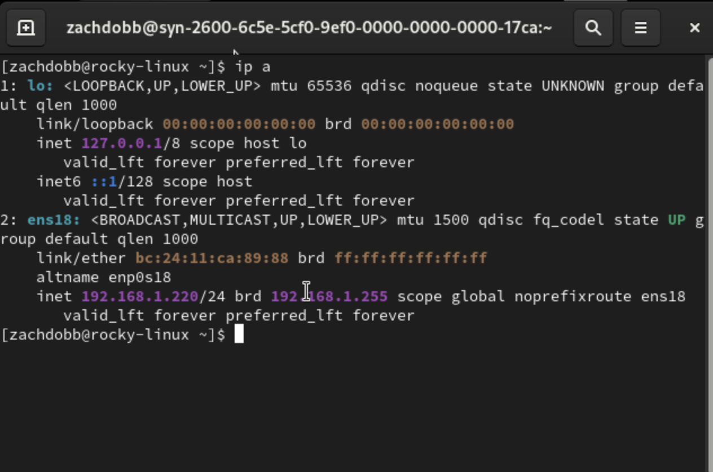
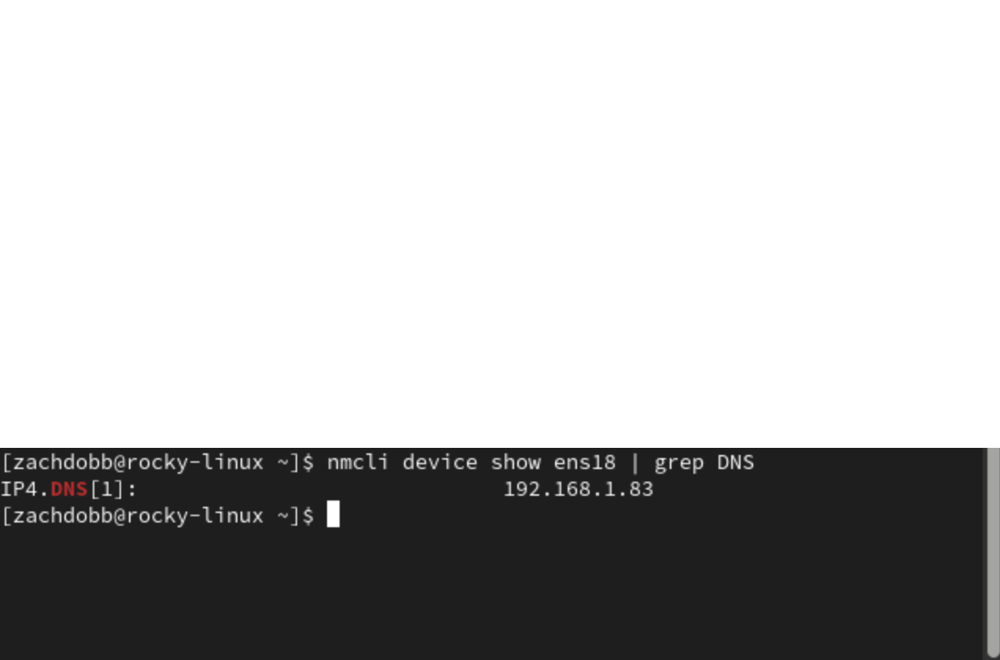
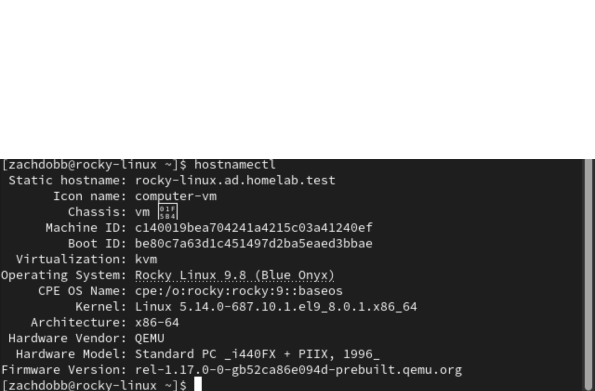
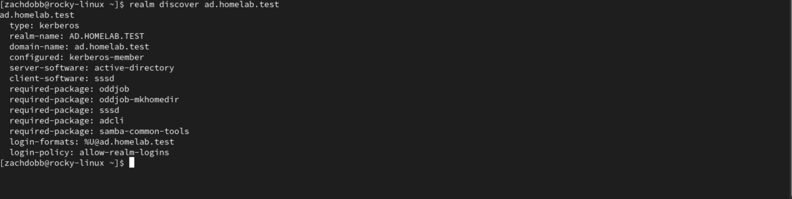
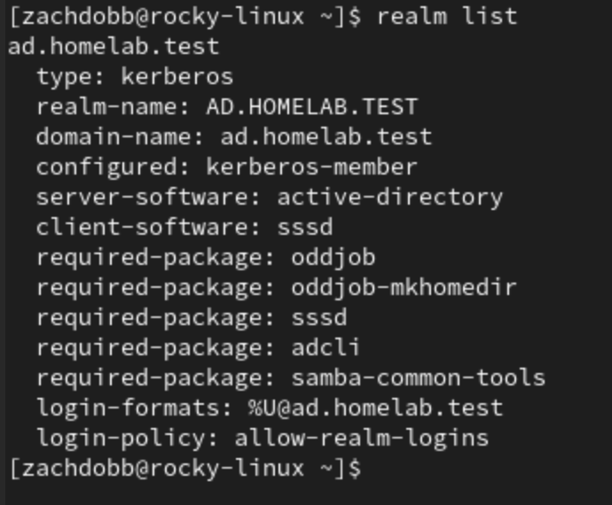
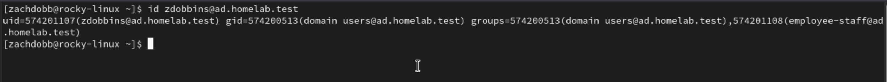
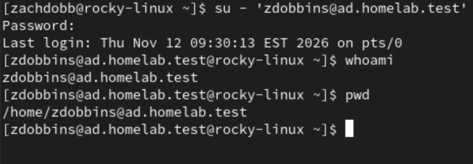

## Rocky Linux Active Directory Lab Screenshots

This section documents the process of integrating a Rocky Linux 9 virtual machine into the existing Windows Server Active Directory environment. The goal was to configure networking and DNS correctly, discover the Active Directory domain, join Rocky Linux to the domain, verify Active Directory users and groups, and successfully authenticate to Linux using a domain account.

### 1. Rocky Linux Network Configuration

The first step was verifying the Rocky Linux VM's basic network configuration.

The `ip a` command was used to confirm that the `ens18` network interface was active and that the Rocky Linux VM had the IPv4 address:

`192.168.1.220/24`

This confirmed that the VM was connected to the same local network as the Windows Server domain controller.



The DNS configuration was then checked using NetworkManager.

The Rocky Linux VM was configured to use:

`192.168.1.83`

as its DNS server. This is the IPv4 address of the Windows Server domain controller, DC-01.

Using the domain controller for DNS is important because Active Directory relies heavily on DNS records to locate domain controllers, LDAP services, Kerberos authentication services, and other domain resources.



The Rocky Linux hostname was also configured as a fully qualified domain name:

`rocky-linux.ad.homelab.test`

A proper hostname was required before Rocky Linux could successfully join Active Directory.

The `hostnamectl` command confirmed that the hostname had been configured correctly.



Together, these screenshots confirm that the Rocky Linux VM had a working network connection, the correct Active Directory DNS server, and a hostname associated with the `ad.homelab.test` domain.

---

### 2. Active Directory Domain Discovery

Before joining Rocky Linux to the domain, I verified that the Linux system could successfully locate and identify the Active Directory environment.

The following command was used:

```bash
realm discover ad.homelab.test
```

The output confirmed that Rocky Linux could discover the domain and identified several important pieces of information.

The system detected:

- **Realm:** `AD.HOMELAB.TEST`
- **Domain:** `ad.homelab.test`
- **Server software:** Active Directory
- **Client software:** SSSD
- **Authentication type:** Kerberos



This step was important because it confirmed that DNS resolution and Active Directory service discovery were working correctly before attempting to join the domain.

During troubleshooting, Active Directory LDAP and Kerberos DNS records were also verified. This helped confirm that Rocky Linux could locate the Windows Server domain controller and the services required for authentication.

---

### 3. Rocky Linux Domain Join

After confirming that Rocky Linux could discover the Active Directory environment, the system was joined to the domain.

The domain join was performed using the Active Directory Administrator account:

```bash
realm join --user=Administrator ad.homelab.test
```

After the join completed, the following command was used to verify domain membership:

```bash
realm list
```

The output displayed:

`configured: kerberos-member`

This confirms that Rocky Linux is officially configured as a member of the Active Directory Kerberos realm.



The output also confirmed that:

- Active Directory is being used as the server software.
- SSSD is being used as the Linux authentication client.
- Kerberos is being used for authentication.
- Domain users are allowed to authenticate to the Linux system.

This step demonstrates successful integration between a Linux server and a Microsoft Active Directory environment.

---

### 4. Active Directory User Verification

After Rocky Linux was successfully joined to the domain, I verified that Active Directory users could be recognized by Linux.

The following command was used:

```bash
id zdobbins@ad.homelab.test
```

The output returned the Active Directory user's UID, GID, and domain group memberships.



The output confirmed that Rocky Linux could identify the Active Directory account:

`zdobbins@ad.homelab.test`

It also showed Active Directory group membership, including groups such as:

- `Domain Users`
- `Employee-Staff`

This demonstrates that Rocky Linux is not only connected to the domain, but can also retrieve centralized user and group information from Active Directory.

This is useful in business environments because administrators can manage user accounts and security groups centrally instead of creating separate local accounts on every Linux server.

---

### 5. Active Directory Login Test

The final step was testing whether an Active Directory user could actually authenticate to the Rocky Linux system.

The domain account was used to start a Linux session:

```bash
su - 'zdobbins@ad.homelab.test'
```

After authentication, the following commands were used to verify the active user and home directory:

```bash
whoami
pwd
```



The successful login confirmed that the Active Directory account could authenticate directly to Rocky Linux.

This demonstrates centralized authentication across both Windows and Linux systems.

Instead of maintaining separate credentials for Windows and Linux machines, Active Directory can provide a single identity that is recognized across multiple operating systems.

---

## What This Lab Demonstrates

This portion of the home lab demonstrates practical experience with integrating Linux into a Windows-based enterprise environment.

The project included:

- Configuring Rocky Linux networking
- Configuring Active Directory DNS
- Troubleshooting DNS resolution
- Configuring a Linux fully qualified domain name
- Discovering Active Directory services
- Joining Linux to an Active Directory domain
- Using Kerberos authentication
- Using SSSD for Linux identity management
- Verifying Active Directory users and groups
- Authenticating to Linux with an Active Directory account
- Troubleshooting cross-platform authentication issues

The final result is a Rocky Linux server that is successfully joined to the `ad.homelab.test` domain and capable of authenticating users managed by Windows Active Directory.
