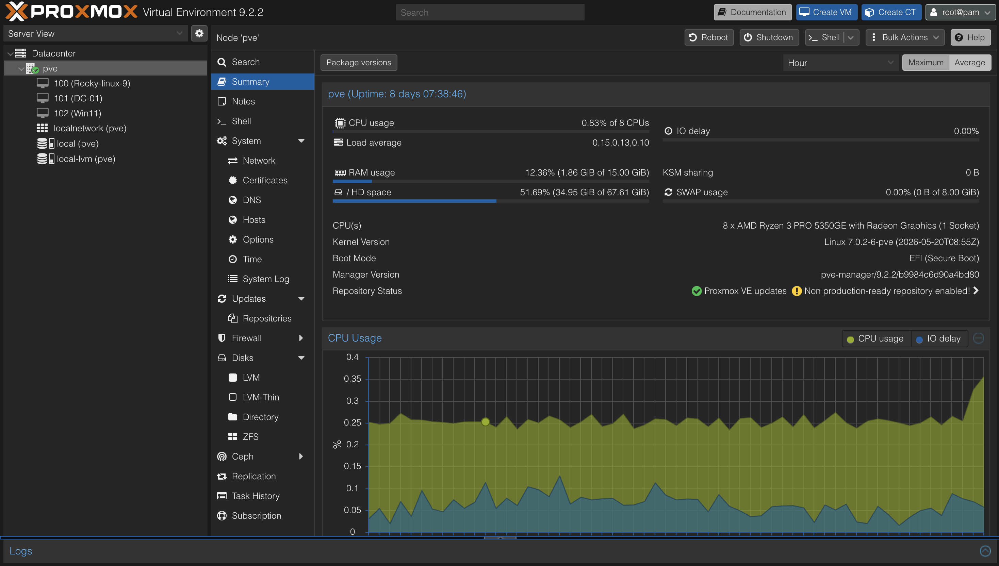

## Proxmox Dashboard

I installed Proxmox VE on my Lenovo ThinkCentre
to create and manage virtual machines for my
home lab.

### Current Virtual Machines
- VM 100: Rocky Linux 9
- VM 101: Windows Server (DC-01)
- VM 102: Windows 11

### Dashboard Screenshot

