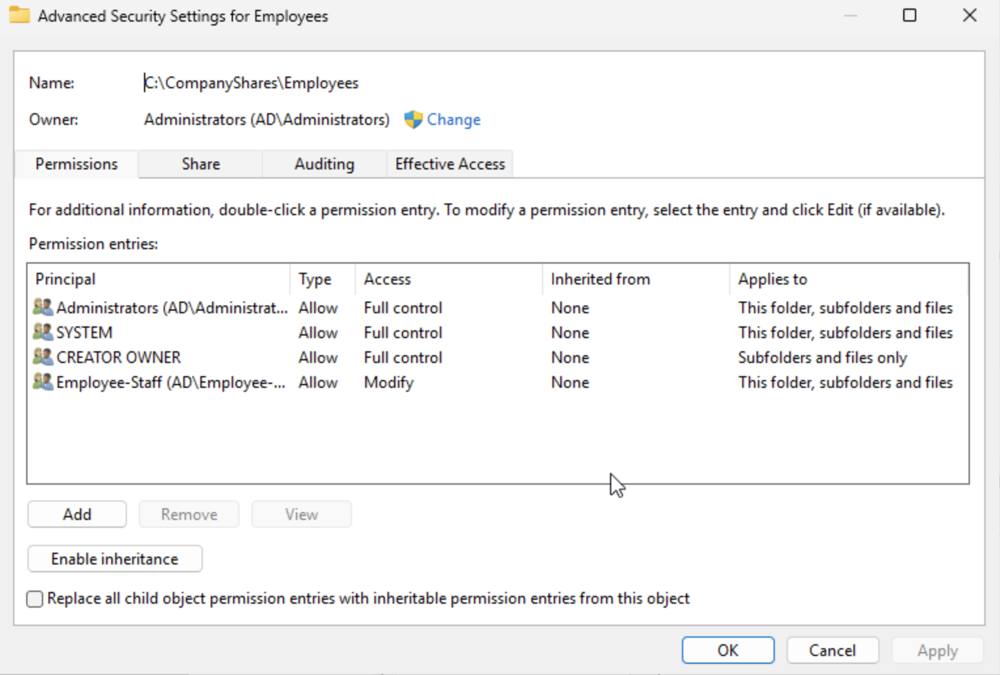
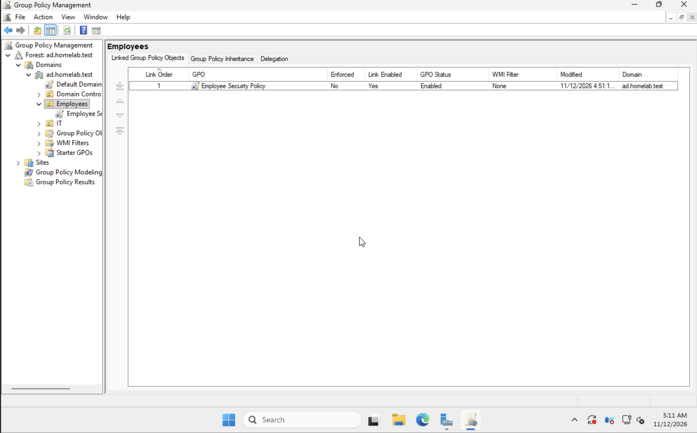
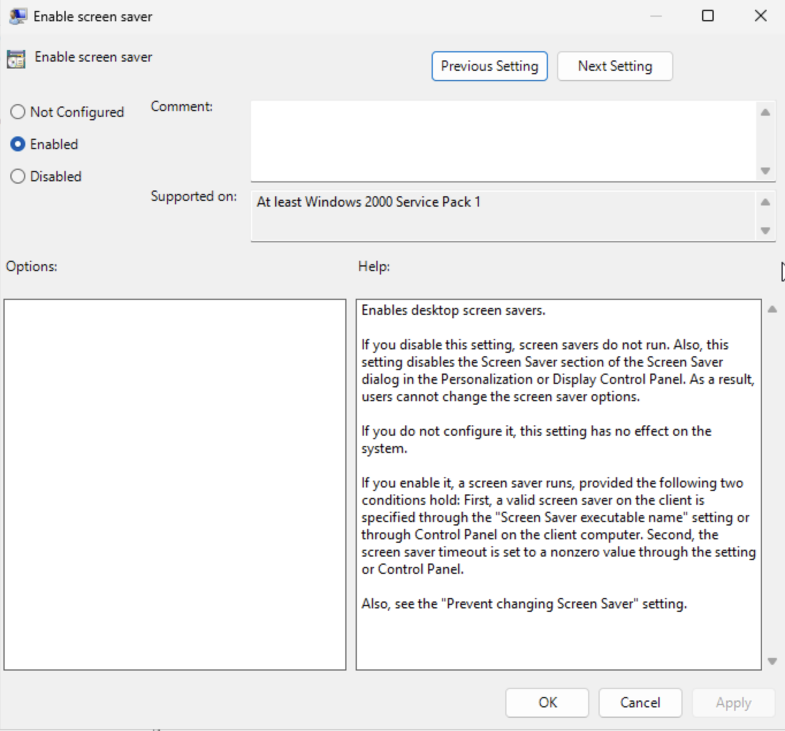
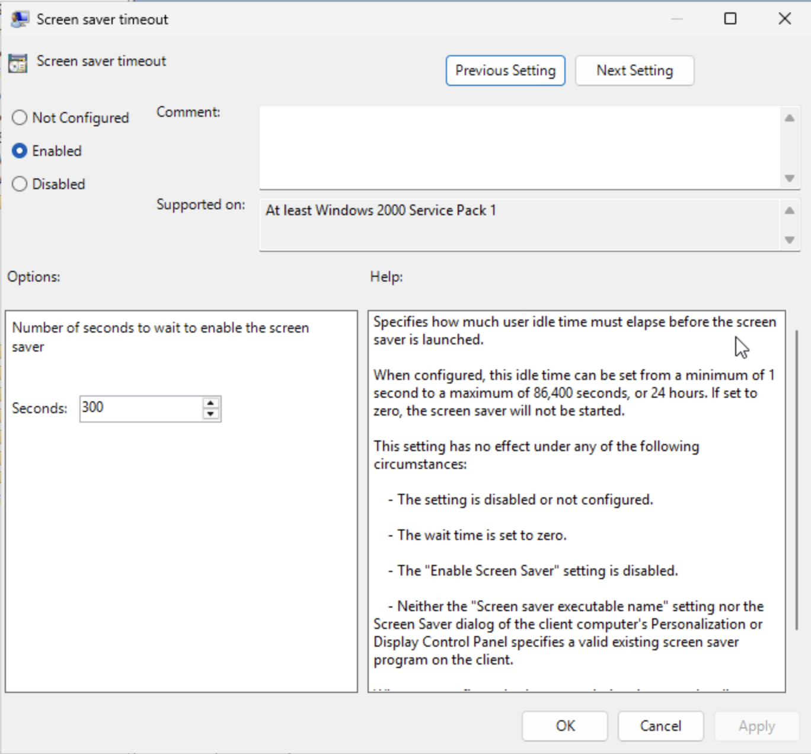
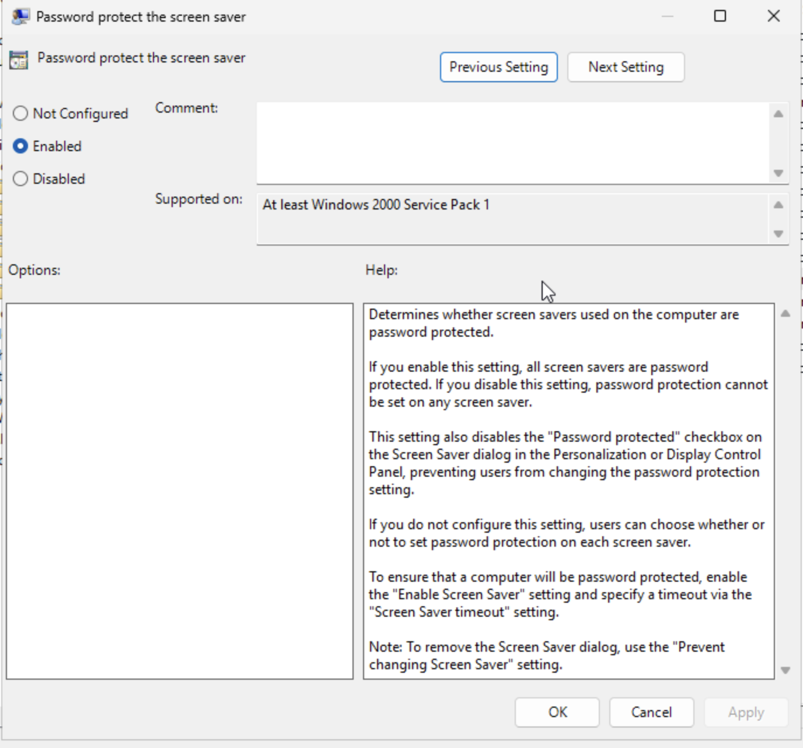
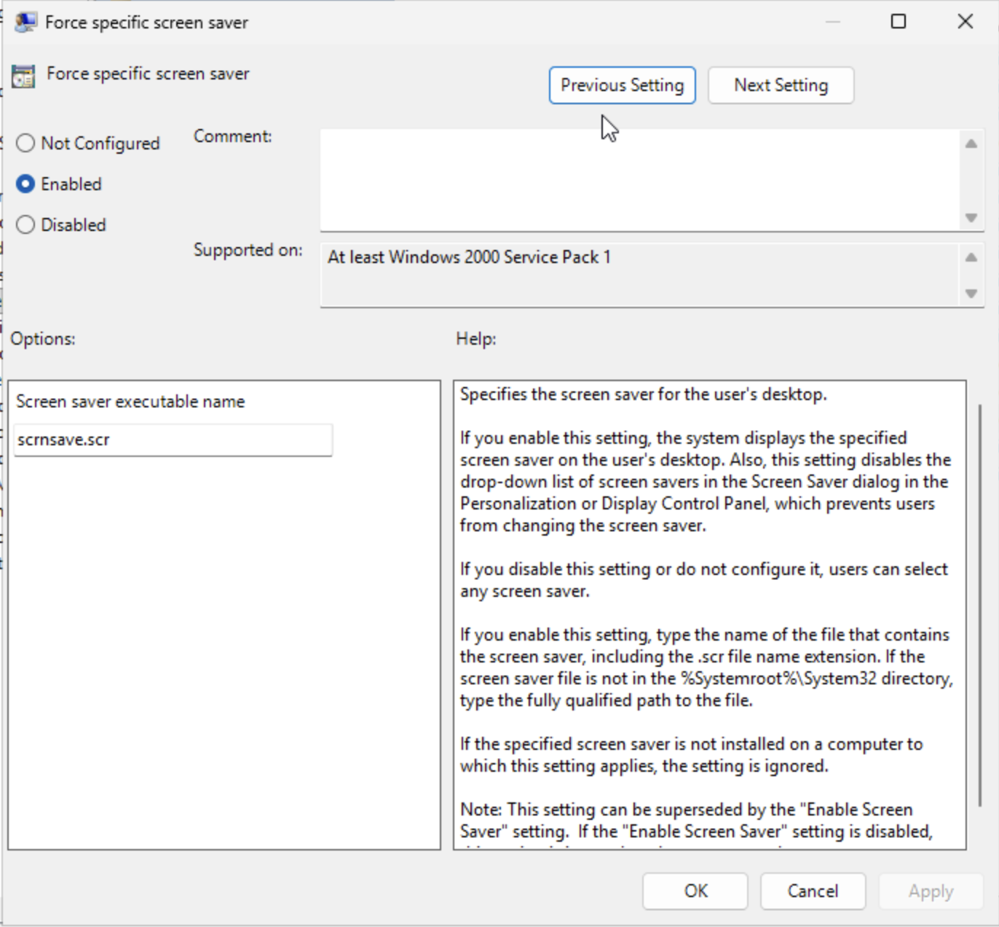
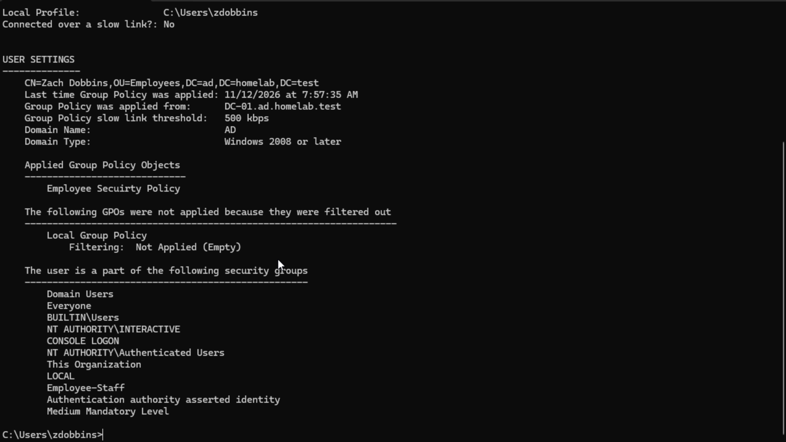

# Active Directory Home Lab

## Project Overview

This project demonstrates how I configured and managed a Windows Server Active Directory environment using Proxmox VE. The goal was to practice real-world IT support, user administration, and network troubleshooting.

## Lab Environment

- **Hypervisor:** Proxmox VE
- **Server:** Windows Server (DC-01)
- **Client:** Windows 11 (PC01)
- **Domain:** ad.homelab.test
- **Services:** Active Directory Domain Services (AD DS) and DNS

## Completed Tasks

1. Configured Windows Server as an Active Directory domain controller.
2. Configured DNS for the domain.
3. Joined a Windows 11 workstation to the domain.
4. Created IT and Employees organizational units.
5. Created employee accounts and verified domain login.
6. Created IT-Staff and Employees-Staff security groups.
7. Assigned users to their appropriate security groups.
8. Troubleshot DNS issues during domain configuration.

## Skills Demonstrated

- Windows Server administration
- Active Directory user and group management
- Domain authentication
- DNS troubleshooting
- Windows 11 domain integration
- IT support fundamentals

## Upcoming Work

- Configure network shares and NTFS permissions.
- Implement Group Policy Objects (GPOs).
- Simulate common Help Desk support tickets.
- Document troubleshooting procedures and results.

## Active Directory Lab Screenshots

### 1. Windows Server Dashboard
Configured Windows Server with Active Directory Domain Services and DNS.

### 2. Active Directory Organization
Created the IT and Employees organizational units in the ad.homelab.test domain.

### 3. IT Security Group
Added John Smith to the IT-Staff security group.

### 4. Employee Security Group
Added the employee account to the Employees-Staff security group.

### 5. Windows 11 Domain Membership
Successfully joined PC01 to ad.homelab.test.

### 6. Employee Login Verification
Verified successful domain authentication using the whoami command.

### 7. DNS Verification
Verified that PC01 could locate DC-01 using an Active Directory DNS SRV lookup.

## Active Directory File Sharing and Permissions

### Project Overview

I configured Windows Server file sharing to simulate how a business manages access to department files. I used Active Directory security groups, NTFS permissions, and SMB network sharing to control employee access.

### Lab Environment

- **Hypervisor:** Proxmox VE
- **Server:** Windows Server (DC-01)
- **Client:** Windows 11 (PC01)
- **Domain:** ad.homelab.test
- **Security Groups:** Employee-Staff and IT-Staff

### Configuration

1. Created Employees and IT folders in `C:\CompanyShares`.
2. Configured NTFS permissions for both folders.
3. Assigned Employee-Staff Modify permissions to the Employees folder.
4. Assigned IT-Staff Modify permissions to the IT folder.
5. Disabled NTFS inheritance and removed unnecessary permissions.
6. Configured SMB sharing for the Employees folder.
7. Assigned Employee-Staff Change and Read share permissions.
8. Removed the Everyone group from the Employees share permissions.

---

### Screenshot 8 - Employees NTFS Permissions

[View Full Screenshot](../screenshots/08-employee-ntfs.png)

I configured NTFS permissions for the Employees folder. The Employee-Staff security group has Modify access, while Administrators and SYSTEM retain Full Control. I disabled inheritance to prevent unnecessary inherited permissions.

### Screenshot 9 - Employees Share Permissions

[View Full Screenshot](../screenshots/09-employees-share.png)

I configured SMB share permissions for the Employees folder. Employee-Staff has Change and Read permissions, allowing authorized employees to access and modify files over the network. I also removed the Everyone group.

### Screenshot 10 - Successful Employee Access

[View Full Screenshot](../screenshots/10-employees-access.png)

I tested the Employees shared folder from my domain-joined Windows 11 virtual machine using an employee account. I successfully accessed `\\dc-01\Employees` and created `Permission-Test.txt`, confirming write access.

### Screenshot 11 - IT Folder Access Restriction

[View Full Screenshot](../screenshots/11-it-access-denied.png)

I tested access to the IT shared folder using a regular employee account. Windows displayed Access Denied, confirming that the employee account could not access restricted IT files.

This demonstrates the principle of least privilege by limiting access based on security group membership.

---

### Skills Demonstrated

- Active Directory administration
- Windows Server administration
- NTFS permissions
- SMB network file sharing
- Security group management
- Role-based access control (RBAC)
- Principle of least privilege
- Windows 11 domain integration
- File permission testing and troubleshooting

### Project Outcome

I successfully configured and tested department-based file access in a simulated business environment. This project helped me gain hands-on experience with Active Directory, Windows Server file sharing, and access control.

## Group Policy (GPO) — Employee Security Policy

### Project Overview

I configured and deployed a Group Policy Object (GPO) in Windows Server to automatically activate a password-protected screen saver after five minutes of inactivity.

This project simulates how IT administrators centrally enforce workstation security policies in a business environment.

### Lab Environment

- **Hypervisor:** Proxmox VE
- **Domain Controller:** DC-01
- **Client:** Windows 11 (PC01)
- **Active Directory Domain:** ad.homelab.test
- **Target OU:** Employees
- **GPO Name:** Employee Security Policy

### Configuration

1. Created a new GPO named Employee Security Policy.
2. Linked the GPO to the Employees organizational unit.
3. Enabled the screen saver.
4. Configured the screen saver timeout to 300 seconds.
5. Enabled password protection for the screen saver.
6. Configured the blank screen saver using `scrnsave.scr`.
7. Refreshed Group Policy on Windows 11 using `gpupdate /force`.
8. Verified the applied policy using `gpresult /r`.
9. Tested the screen saver and confirmed that authentication was required when returning to the session.

---

### Screenshot 12 — GPO Creation and OU Linking

[View Full Screenshot](../screenshots/12-gpo-created.png)

Created the Employee Security Policy GPO and linked it to the Employees OU. This allows user-based security settings to target employee accounts within the organizational unit.

### Screenshot 13 — Enable Screen Saver

[View Full Screenshot](../screenshots/13-screen-saver-enabled.png)

Enabled the screen saver through Group Policy to establish an inactivity-based security control for employee sessions.

### Screenshot 14 — Screen Saver Timeout

[View Full Screenshot](../screenshots/14-screen-saver-timeout.png)

Configured a 300-second (5-minute) screen saver timeout. This helps reduce the risk of unattended workstations remaining accessible.

### Screenshot 15 — Password Protection

[View Full Screenshot](../screenshots/15-password-protection.png)

Enabled password protection so employees must authenticate when returning from the screen saver.

### Screenshot 16 — Blank Screen Saver

[View Full Screenshot](../screenshots/16-blank-screen-saver.png)

Configured `scrnsave.scr` as the required screen saver executable, providing a blank display after inactivity.

### Screenshot 17 — Group Policy Verification

[View Full Screenshot](../screenshots/17-gpo-verification.png)

Executed `gpresult /r` on the Windows 11 domain-joined client. The results confirmed that Employee Security Policy was applied to the employee account.

I also tested the screen saver after five minutes of inactivity and verified that the session required authentication.

---

### Skills Demonstrated

- Windows Server administration
- Active Directory Group Policy management
- Organizational Unit (OU) targeting
- Security policy configuration
- Centralized workstation management
- Group Policy deployment and troubleshooting
- `gpupdate` and `gpresult` commands
- Security testing and verification

### Project Outcome

Successfully deployed and verified an Active Directory Group Policy that enforces a password-protected screen saver for employee accounts. This project demonstrates centralized security administration and practical Group Policy troubleshooting.

