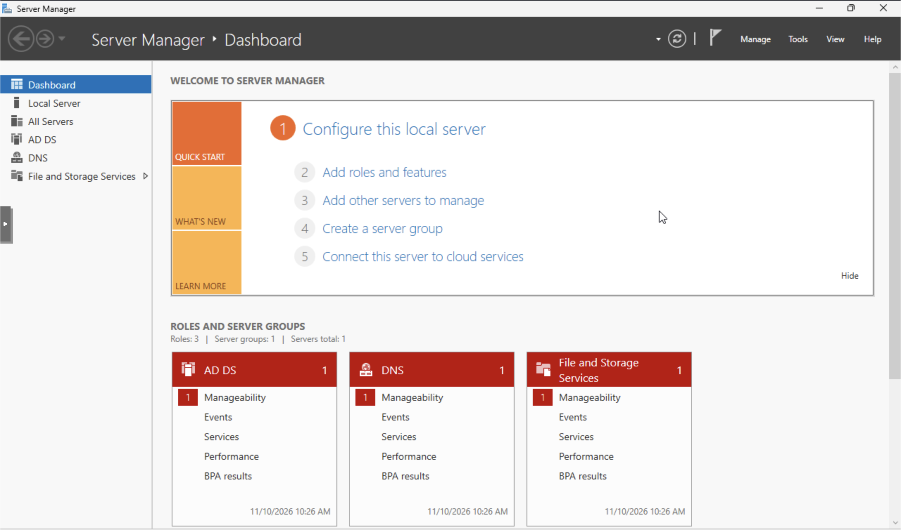
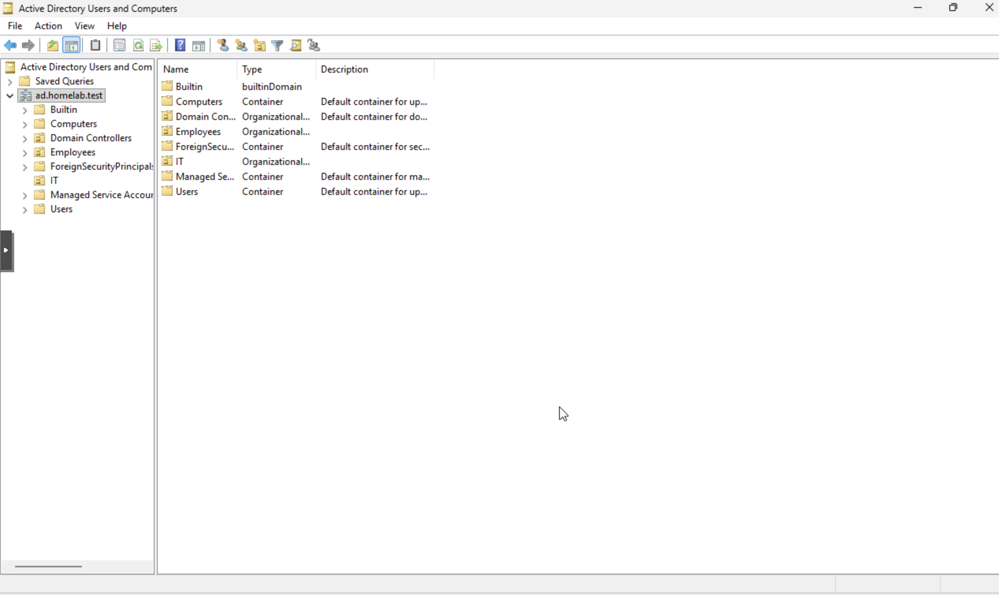
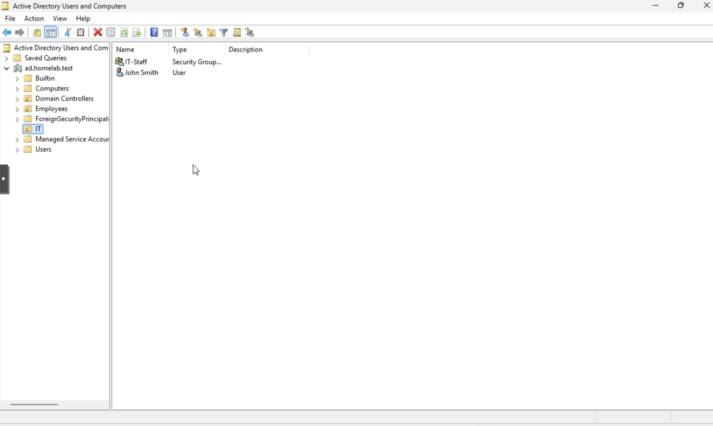
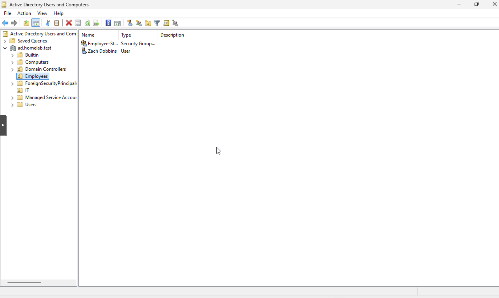
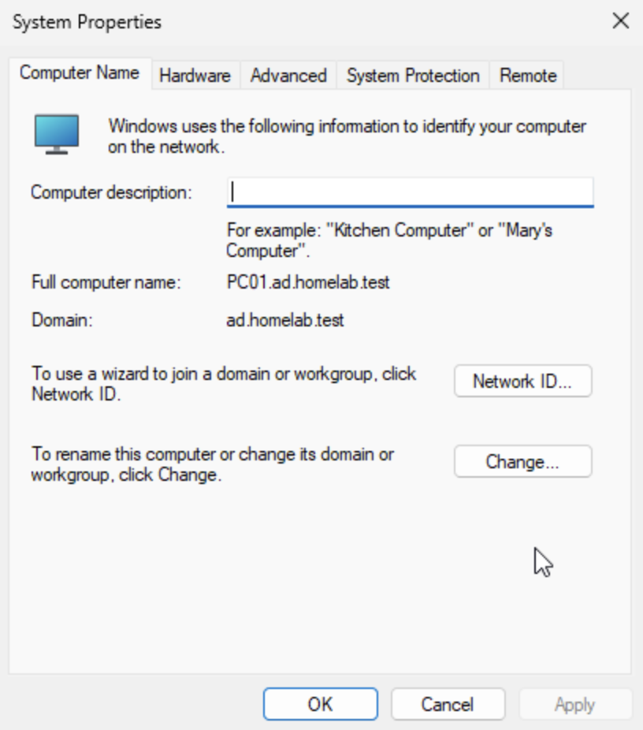
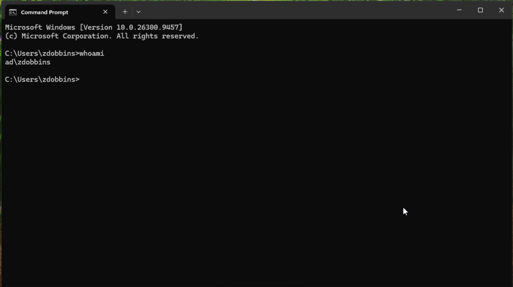
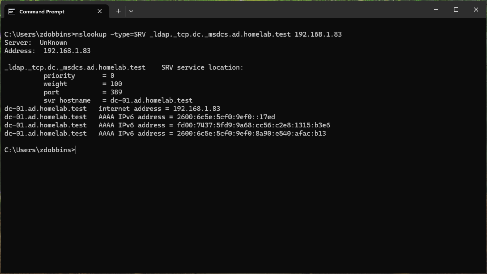
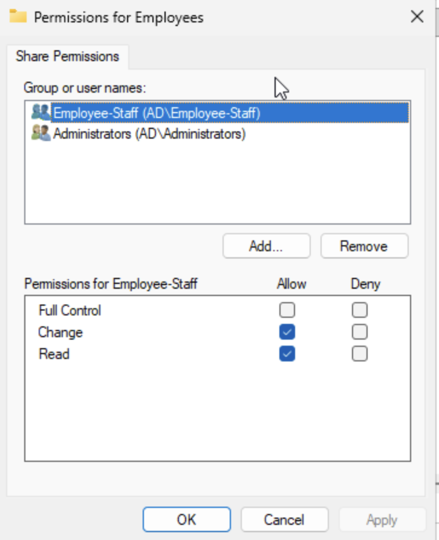
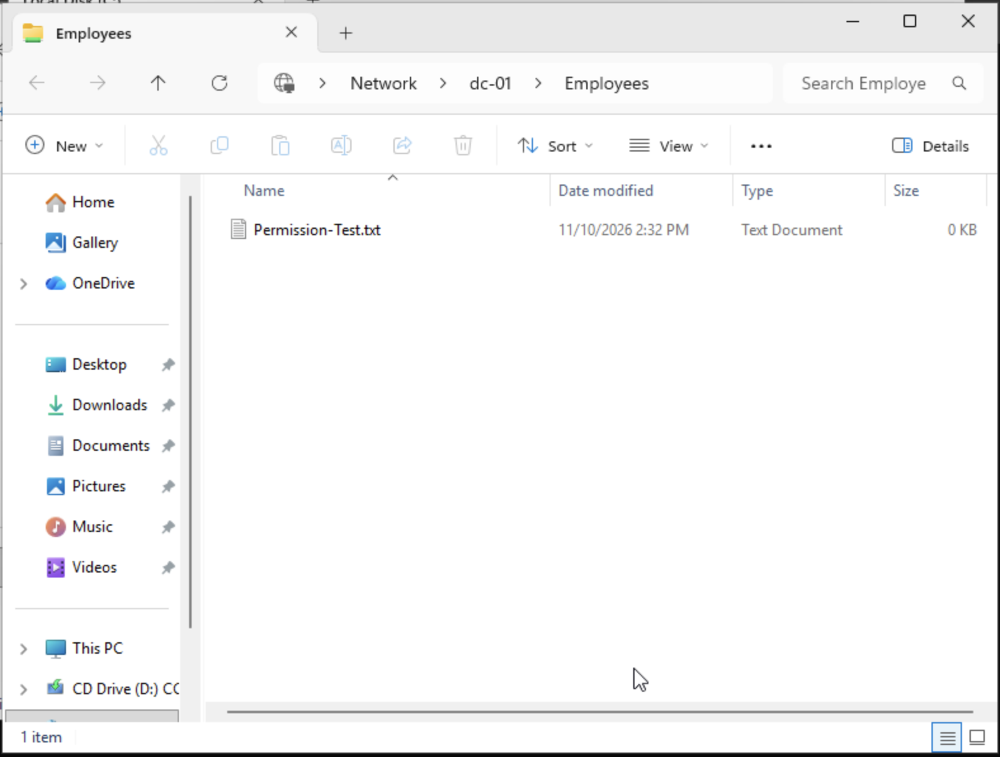
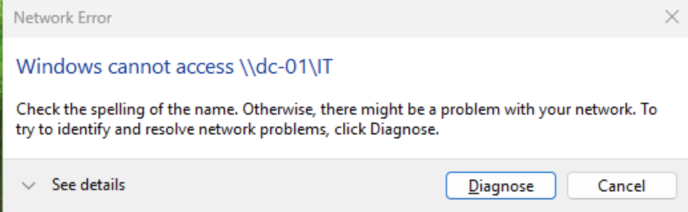

# Active Directory Home Lab

## Project Overview

This project demonstrates how I configured and managed a Windows Server Active Directory environment using Proxmox VE. The goal was to practice real-world IT support, user administration, and network troubleshooting.

## Lab Environment

- **Hypervisor:** Proxmox VE
- **Server:** Windows Server (DC-01)
- **Client:** Windows 11 (PC01)
- **Domain:** ad.homelab.test
- **Services:** Active Directory Domain Services (AD DS) and DNS

## Completed Tasks

1. Configured Windows Server as an Active Directory domain controller.
2. Configured DNS for the domain.
3. Joined a Windows 11 workstation to the domain.
4. Created IT and Employees organizational units.
5. Created employee accounts and verified domain login.
6. Created IT-Staff and Employees-Staff security groups.
7. Assigned users to their appropriate security groups.
8. Troubleshot DNS issues during domain configuration.

## Skills Demonstrated

- Windows Server administration
- Active Directory user and group management
- Domain authentication
- DNS troubleshooting
- Windows 11 domain integration
- IT support fundamentals

## Upcoming Work

- Configure network shares and NTFS permissions.
- Implement Group Policy Objects (GPOs).
- Simulate common Help Desk support tickets.
- Document troubleshooting procedures and results.

## Active Directory Lab Screenshots

### 1. Windows Server Dashboard
Configured Windows Server with Active Directory Domain Services and DNS.

### 2. Active Directory Organization
Created the IT and Employees organizational units in the ad.homelab.test domain.

### 3. IT Security Group
Added John Smith to the IT-Staff security group.

### 4. Employee Security Group
Added the employee account to the Employees-Staff security group.

### 5. Windows 11 Domain Membership
Successfully joined PC01 to ad.homelab.test.

### 6. Employee Login Verification
Verified successful domain authentication using the whoami command.

### 7. DNS Verification
Verified that PC01 could locate DC-01 using an Active Directory DNS SRV lookup.

## Active Directory File Sharing and Permissions

### 8. Employees NTFS Permissions
Configured NTFS permissions for the Employees folder and assigned Employee-Staff Modify access.

### 9. Employees Share Permissions
Configured SMB sharing with Employee-Staff Change and Read permissions.

### 10. Employee File Share Access
Successfully accessed the Employees share from Windows 11 and created Permission-Test.txt.

### 11. IT Folder Access Restriction
Tested access to the IT share using an employee account and received Access Denied.

